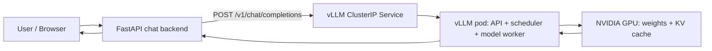

# GKE + vLLM Inference Engineering Lab

> A hands-on, evidence-first learning lab for Cloud/DevOps engineers who want to understand the complete path from a chat request to NVIDIA GPU inference on Google Kubernetes Engine.

**Status:** Phase 0 — planning and offline preparation. **No GCP resources have been created or validated yet.**

## What we're building

A small FastAPI chat application will call an OpenAI-compatible **vLLM** HTTP endpoint running in a GPU-enabled Kubernetes pod. vLLM will serve a small open-weight instruction model using an NVIDIA GPU. We'll observe requests, GPU memory, model loading, scheduling, token streaming, prefill, decode, KV-cache behavior, and controlled failure scenarios.

**Key distinction:** Kubernetes schedules the **vLLM pod onto a GPU node**; the **vLLM scheduler** schedules inference work for the GPU. These are separate schedulers. The vLLM pod is a normal application workload that requests GPU resources; it is not the Kubernetes API server or a per-node DaemonSet.

## Design decisions for our first lab

| Choice | Initial plan | Why |
| --- | --- | --- |
| GKE mode | **Standard, zonal**, Terraform-managed | Direct visibility into node pools, node OS, scheduling, and teardown |
| GPU | **One NVIDIA T4 (16 GB)** if quota/capacity allows | Small, practical accelerator for introductory inference experiments |
| Model | Small instruction model; candidate: `Qwen/Qwen2.5-0.5B-Instruct` | Keep model weight and KV-cache demands low; validate with pinned vLLM version |
| Serving | One vLLM Deployment replica, one internal ClusterIP Service | Isolate the inference engine from the application |
| App | FastAPI, initially run locally via `kubectl port-forward` | Test HTTP end-to-end without a public load balancer |
| Source of truth | Terraform + Kubernetes manifests + scripts + documented evidence | Repeatability and learnable steps |
| Spending | Initial **$3–$5 target**, **not a hard cap** | Prepare offline, check quota/pricing, run short paid session, destroy resources |

**Autopilot note:** In GKE Autopilot, you ordinarily specify GPU requirements in workloads rather than manually creating a conventional GPU node pool. The first lab uses **GKE Standard** to expose the node-pool internals. Autopilot is a later comparison exercise.

## Lesson and experiment map

| Phase | Learning objective | Experiments |
| --- | --- | --- |
| 0 — Before billing | Architecture, quota, cost and teardown plan | Read design, prepare IaC and scripts, validate offline |
| A — GPU infrastructure | Understand VM/OS/driver/CUDA/device-plugin/GKE relationships | Terraform cluster, T4 pool, node inspection, `nvidia-smi`, GPU scheduling |
| B — Serving | Understand the vLLM container and model startup | Deploy one pod, inspect weights loading, readiness and API |
| C — Application | Observe request flow end to end | FastAPI → Service → vLLM → GPU → text, streaming, errors |
| D — Internals | Make prefill, decode, KV cache and PagedAttention concrete | Prompt-length tests, generation metrics, prefix reuse, concurrent requests |
| E — Operations | Troubleshoot as a platform engineer | Pod Pending, restarts, OOM symptoms, quotas, networking, observability |
| F — Scaling | Learn replica and distributed-inference decisions | Scale 0↔1 live; document 2 replicas/tensor parallelism as later paid extension |
| G — Closeout | Prove cleanup and publish verified findings | Terraform destroy, verify resources, record limitations and actual costs |

See [the learning roadmap](docs/ROADMAP.md), [architecture](docs/ARCHITECTURE.md), and [cost/cleanup guardrails](docs/COST_AND_SAFETY.md).

## Start here

1. **Do not run `terraform apply` yet.** Finish the local preparation and confirm your GCP billing status, actual regional pricing, GPU quota, and capacity.
2. Review [the roadmap](docs/ROADMAP.md) and the task issues.
3. Prepare a *dedicated lab project* and configure billing alerts. **Cloud Billing budgets alert but do not normally stop Compute Engine/GKE usage.**
4. Apply infrastructure only during an explicitly planned GPU lab window, then delete and **verify** all chargeable resources.
5. Record **observed** results separately from planned/expected behavior.

### Useful documentation

- [vLLM OpenAI-compatible serving](https://docs.vllm.ai/en/latest/serving/openai_compatible_server.html)
- [GKE GPUs overview](https://cloud.google.com/kubernetes-engine/docs/how-to/gpus)
- [GKE GPU workloads on Autopilot](https://cloud.google.com/kubernetes-engine/docs/how-to/autopilot-gpus)
- [GCP pricing calculator](https://cloud.google.com/products/calculator)
- [Cloud Billing budgets](https://cloud.google.com/billing/docs/how-to/budgets)

## Repository discipline

- No real credentials, tokens, Terraform state files, billing identifiers, or service-account JSON committed to Git.
- No default public inference endpoint; prefer ClusterIP plus authenticated app access or local port-forward.
- No claim of a GPU experiment passing until logs, commands, and observed results are captured.
- Pin container and model versions for reproducibility; don't assume a moving `latest` tag works.
- Separate **planned**, **implemented**, **locally validated**, and **tested on actual GKE GPU** status.
- Track one focused task per GitHub issue / change; link evidence and estimated vs actual cost.
- The project is educational, not a production-hardened deployment without further security/reliability review.

## Current progress

- [x] Repository initialized with a documented scope and reference architecture
- [ ] Offline code and Terraform validation
- [ ] GCP billing and GPU quota verified
- [ ] GKE/T4 resources provisioned
- [ ] vLLM and FastAPI inference request demonstrated
- [ ] GPU/inference experiments captured
- [ ] Infrastructure destroyed and charges verified

> **No live GPU experiments have been performed yet.** This README will evolve as we complete each evidence-backed task.
