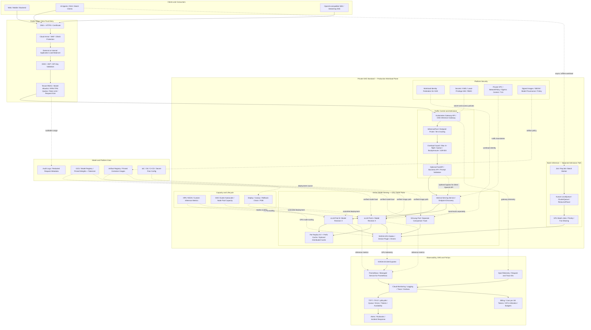

# GKE + vLLM Inference Engineering Lab

> **Phase 1 PAUSED / GPU compute shutdown verified (2026-10-22).** Operator CLI inventory showed **0 GKE clusters, 0 VMs and 0 disks**; Artifact Registry `ai-inference` (98.002 MB) remains. **[Complete production end-goal Mermaid architecture + detailed pending/acceptance register](docs/PRODUCTION_TARGET_ARCHITECTURE_AND_PENDING_REGISTER.md)** · **[Stopped-state and teardown receipts](docs/STOPPED_STATE_AND_PRODUCTION_ROADMAP_2026-10-22.md)**. Phase 2 starts with GPU quota/cost/IaC preflight, then a real GPU node pool in GKE. These production features are **targets, not deployed capabilities**.

> A hands-on, evidence-first learning lab for Cloud/DevOps engineers who want to understand the complete path from a chat request to NVIDIA GPU inference on Google Kubernetes Engine.

**Historical Phase 1 result (2026-10-22):** CPU-only GKE + separate NVIDIA L4 VM **end-to-end inference verified**, benchmarked, then **deleted** (empty project-wide GKE/VM inventory). GKE GPU node pool, full production security, observability and SGLang **pending**. See [live lab receipt](docs/LIVE_LAB_2026-10-22.md) and [current pending register](docs/PRODUCTION_TARGET_ARCHITECTURE_AND_PENDING_REGISTER.md).

## Production end-goal architecture (target — not deployed)

This is the **canonical production architecture** for the project, kept in sync with [the detailed target architecture and acceptance register](docs/PRODUCTION_TARGET_ARCHITECTURE_AND_PENDING_REGISTER.md). It includes the client/edge path, identity and rate limits, inference routing, vLLM GPU serving, separate SGLang comparison, Kueue batch admission, scaling, security, observability and FinOps. **It is a target, not a representation of currently running cloud resources.**

**Current vs target:** In completed Phase 1, FastAPI ran on CPU-only GKE and vLLM ran on a separate NVIDIA L4 VM over VPC peering. Both compute resources were subsequently deleted. **Next:** reconcile Terraform state and budget/quota, then run vLLM *inside GKE* on an actual L4 GPU node pool. See [the complete implementation status and acceptance criteria](docs/PRODUCTION_TARGET_ARCHITECTURE_AND_PENDING_REGISTER.md).

**Key distinction:** Kubernetes schedules the **vLLM pod onto a GPU node**; the **vLLM scheduler** schedules inference work for the GPU. These are separate schedulers. The vLLM pod is a normal application workload that requests GPU resources; it is not the Kubernetes API server or a per-node DaemonSet.

## Design decisions for our first lab

| Choice | Initial plan | Why |
| --- | --- | --- |
| GKE mode | **Standard, zonal**, Terraform-managed | Direct visibility into node pools, node OS, scheduling, and teardown |
| GPU | **Existing NVIDIA L4 VM** for the validated phase; a GKE L4 GPU pool remains a separately approved paid experiment | Small, practical accelerator for introductory inference experiments |
| Model | Small instruction model; candidate: `Qwen/Qwen2.5-0.5B-Instruct` | Keep model weight and KV-cache demands low; validate with pinned vLLM version |
| Serving | One vLLM Deployment replica, one internal ClusterIP Service | Isolate the inference engine from the application |
| App | FastAPI, initially run locally via `kubectl port-forward` | Test HTTP end-to-end without a public load balancer |
| Source of truth | Terraform + Kubernetes manifests + scripts + documented evidence | Repeatability and learnable steps |
| Spending | Initial **$3–$5 target**, **not a hard cap** | Prepare offline, check quota/pricing, run short paid session, destroy resources |

**Autopilot note:** In GKE Autopilot, you ordinarily specify GPU requirements in workloads rather than manually creating a conventional GPU node pool. The first lab uses **GKE Standard** to expose the node-pool internals. Autopilot is a later comparison exercise.

## Lesson and experiment map

| Phase | Learning objective | Experiments |
| --- | --- | --- |
| 0 — Before billing | Architecture, quota, cost and teardown plan | Read design, prepare IaC and scripts, validate offline |
| A — GPU infrastructure | Understand VM/OS/driver/CUDA/device-plugin/GKE relationships | Terraform cluster, T4 pool, node inspection, `nvidia-smi`, GPU scheduling |
| B — Serving | Understand the vLLM container and model startup | Deploy one pod, inspect weights loading, readiness and API |
| C — Application | Observe request flow end to end | FastAPI → Service → vLLM → GPU → text, streaming, errors |
| D — Internals | Make prefill, decode, KV cache and PagedAttention concrete | Prompt-length tests, generation metrics, prefix reuse, concurrent requests |
| E — Operations | Troubleshoot as a platform engineer | Pod Pending, restarts, OOM symptoms, quotas, networking, observability |
| F — Scaling | Learn replica and distributed-inference decisions | Scale 0↔1 live; document 2 replicas/tensor parallelism as later paid extension |
| G — Closeout | Prove cleanup and publish verified findings | Terraform destroy, verify resources, record limitations and actual costs |

See [the learning roadmap](docs/ROADMAP.md), [architecture](docs/ARCHITECTURE.md), and [cost/cleanup guardrails](docs/COST_AND_SAFETY.md).

## Start here

1. **A billable GKE cluster was provisioned on 2026-10-22.** Check current resource state and costs before further applies; review the exact Terraform destroy plan before ending the lab.
2. Review [the roadmap](docs/ROADMAP.md) and the task issues.
3. Prepare a *dedicated lab project* and configure billing alerts. **Cloud Billing budgets alert but do not normally stop Compute Engine/GKE usage.**
4. Apply infrastructure only during an explicitly planned GPU lab window, then delete and **verify** all chargeable resources.
5. Record **observed** results separately from planned/expected behavior.

### Useful documentation

- [vLLM OpenAI-compatible serving](https://docs.vllm.ai/en/latest/serving/openai_compatible_server.html)
- [GKE GPUs overview](https://cloud.google.com/kubernetes-engine/docs/how-to/gpus)
- [GKE GPU workloads on Autopilot](https://cloud.google.com/kubernetes-engine/docs/how-to/autopilot-gpus)
- [GCP pricing calculator](https://cloud.google.com/products/calculator)
- [Cloud Billing budgets](https://cloud.google.com/billing/docs/how-to/budgets)

## Repository discipline

- No real credentials, tokens, Terraform state files, billing identifiers, or service-account JSON committed to Git.
- No default public inference endpoint; prefer ClusterIP plus authenticated app access or local port-forward.
- No claim of a GPU experiment passing until logs, commands, and observed results are captured.
- Pin container and model versions for reproducibility; don't assume a moving `latest` tag works.
- Separate **planned**, **implemented**, **locally validated**, and **tested on actual GKE GPU** status.
- Track one focused task per GitHub issue / change; link evidence and estimated vs actual cost.
- The project is educational, not a production-hardened deployment without further security/reliability review.

## Current progress

- [x] Repository initialized with a documented scope and reference architecture
- [ ] Offline code and Terraform validation
- [ ] GCP billing and GPU quota verified
- [x] CPU-only GKE cluster provisioned; separate NVIDIA L4 GPU VM serving vLLM
- [x] FastAPI-to-vLLM real inference request demonstrated across VPC peering
- [ ] GKE GPU node pool and GPU Pod scheduling demonstrated
- [x] Phase 1 GPU VM inference benchmarks and Prometheus/DCGM evidence captured; GKE GPU Pod experiments pending
- [x] GKE cluster, L4 GPU VM and disks deleted (verified by operator CLI inventories); billing charges may lag and Artifact Registry remains

> **Verified Phase 1:** authenticated end-to-end Qwen inference, GPU VM concurrency benchmarks, Prometheus/DCGM targets UP, and later GKE/GPU VM teardown via project-wide CLI inventories. **Still pending:** GPU Pod scheduling in GKE, production security and monitoring, full cost reconciliation, and SGLang comparison. See [the pending register](docs/PRODUCTION_TARGET_ARCHITECTURE_AND_PENDING_REGISTER.md).
