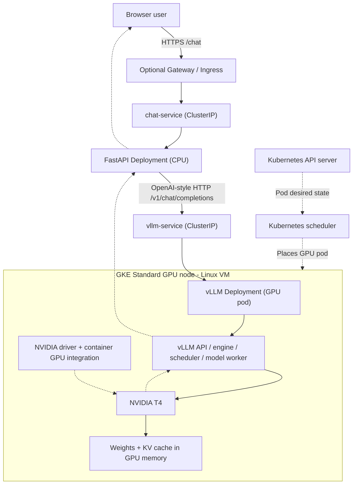

# Architecture: from browser to NVIDIA GPU

> **Design only:** all architecture below is a proposed teaching lab, not a deployed GCP environment.

## Control plane versus request (data) plane



**Initial cheap mode:** FastAPI runs on your laptop and reaches the vLLM ClusterIP using `kubectl port-forward service/vllm-service 8000:8000`. In this mode there is **no public GKE Gateway or chat pod**. Later we deploy a FastAPI CPU pod and test Service-to-Service traffic; an external Gateway is optional.

## Components and responsibilities

| Component | Runs where | Owns |
| --- | --- | --- |
| GKE control plane | Google-managed | Kubernetes objects, scheduling orchestration; **not inference scheduling** |
| GPU worker node | Compute Engine Linux VM | CPU, RAM, NVIDIA GPU, kubelet/runtime/drivers |
| NVIDIA GPU device plugin | Infrastructure pod on GPU-enabled node | Advertises extended resource `nvidia.com/gpu` to kubelet |
| vLLM Deployment/pod | Linux container on a GPU node | HTTP serving, request validation, tokenization, inference scheduling, model worker |
| GPU driver + CUDA stack | Host/container components | Exposes GPU compute to vLLM's model operations |
| NVIDIA GPU | Hardware attached to host VM | Runs parallel model computations, stores weights and KV-cache tensors |
| `vllm-service` | Kubernetes ClusterIP | Stable DNS/network route to ready serving pods; **not a model router** |
| FastAPI app | Mac initially; CPU pod later | User HTTP endpoint, prompt assembly, inference API client, responses |

### The request lifecycle

1. User sends JSON `{"message":"What is Kubernetes?"}` to FastAPI `/chat`.
2. FastAPI constructs the model API request with its chat messages and selected model ID.
3. FastAPI sends an HTTP POST to `http://vllm-service:8000/v1/chat/completions` (inside the cluster) or to the locally forwarded port when running on your Mac.
4. The Kubernetes Service routes the request to a **ready** vLLM pod.
5. The vLLM API server validates the request and applies the model's chat template and tokenizer.
6. vLLM's **own inference scheduler** queues/adopts token work; it is **not** the Kubernetes pod scheduler.
7. vLLM's model worker executes Transformer operations on the allocated GPU, using model weights preloaded when the server started.
8. **Prefill** processes uncached input context; generated attention keys/values are stored in the **KV cache**.
9. **Decode** generates new tokens, reusing cached attention state. **PagedAttention** is part of block-organized KV-cache management in applicable vLLM implementations.
10. Generated tokens are converted into text and returned through the API, optionally as an incremental stream.
11. FastAPI relays the answer to the browser.

The application **does not** submit a Kubernetes API command for each question; Kubernetes is already running the model server. One vLLM pod can service multiple requests with batching.

## Replicas versus multiple GPUs for one instance

```text
Replicas (data parallel serving):                Model parallel serving:
vLLM service                                      vLLM serving instance
    |                                                  |
    +--> vLLM pod 1 --> GPU 1, model copy A            +--> GPU 1: model shard
    +--> vLLM pod 2 --> GPU 2, model copy B            +--> GPU 2: model shard
```

A replica is a serving instance, **not a user session**. A single replica can handle many users concurrently. Two one-GPU replicas require two available GPU allocations (potentially on the same multi-GPU node). Tensor parallelism across GPUs requires additional vLLM configuration, not merely a larger Kubernetes GPU resource limit.

## What we will observe

- Pod-to-node placement, GPU capacity and allocatable, device-plugin health, `nvidia-smi`
- vLLM startup/readiness, model load times, logs and GPU memory use
- Raw HTTP request vs API response, streaming and error cases
- vLLM scheduler/queue metrics, time-to-first-token, input/output token counts
- KV-cache utilization, prefix-cache hits where supported, concurrent-request effects
- Runtime failures, clean shutdown, actual versus estimated cost

## What this design does NOT claim

- A one-T4 experiment does **not** demonstrate multi-GPU tensor/pipeline parallelism or GPU-to-GPU fabric performance.
- CUDA driver internals, KV-cache block tables, or exact GPU kernels are not inferable from `nvidia-smi` alone.
- GKE Autopilot and Standard do not have the same node-pool ownership model; this primary lab uses Standard.
- This is not a claim about proprietary ChatGPT/Gemini deployment internals.
