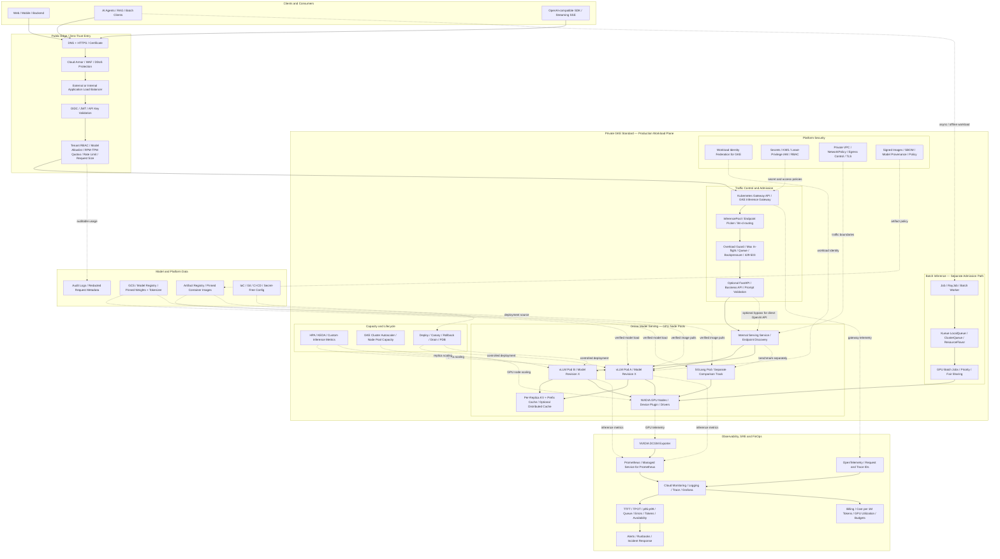
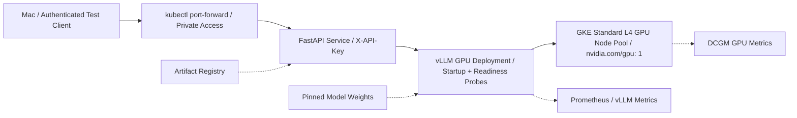
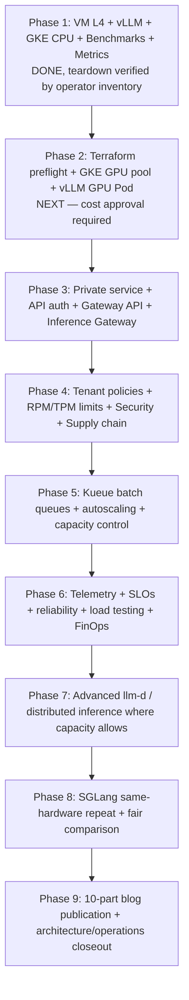

# Production LLM Inference on GKE — Target Architecture and Complete Pending Register

**Baseline date:** 2026-10-22. **Project:** `gke-vllm-learning-lab`. **Status:** Phase 1 completed as a learning exercise and PAUSED; GKE and GPU VM deleted (operator-provided project-wide listings); production architecture NOT deployed. **Source of truth:** [stopped-state receipts](STOPPED_STATE_AND_PRODUCTION_ROADMAP_2026-10-22.md). **PR #11 merged into main** as squash commit `f4e0a4fca88e0ecd4b7ae1c44551018640d47b8f`. Remaining Artifact Registry: `ai-inference`, 98.002 MB observed. Recheck actual resources before every apply.

This document is a **target architecture and acceptance backlog**, not a claim that every optional component is mandatory, currently supported by the installed versions, or proven on one L4. All implementation choices must be validated against current GKE/Gateway/Kueue/llm-d/SGLang versions, security posture, hardware quota, cost and product requirements. The diagram shows a multi-replica **future production topology**, while the next hands-on exercise starts with **one GPU**.

## 1. End-goal reference architecture — Mermaid

**Reading the diagram:** Solid arrows indicate representative request or dependency paths; dashed arrows represent optional, control, observability or future paths. Components like the FastAPI layer, distributed cache, Kueue, multi-replica pools and SGLang are deliberately **separate or optional**. Inference Gateway routes **online requests**; Kueue admits **batch jobs**. GKE scheduler places Pods; vLLM/SGLang engine schedules tokens. A gateway does not replace IAM, authentication, WAF, tenant policy or an application API.

## 2. Minimal next-day GKE GPU lab — deliberately smaller than target

**Do not** add a public load balancer, managed gateway, extra GPU replicas or paid managed observability by default. First prove the GPU node is allocatable and one vLLM Pod is healthy. Confirm quota, availability, Terraform state, and spend approval before provisioning. Reuse the existing Artifact Registry only after checking image tags/digests.

## 3. Complete work register

Legend: **DONE** = verified in Phase 1, **PARTIAL** = some lab proof only, **PENDING** = not implemented or verified, **OPTIONAL** = decision required based on requirements. This register is intentionally broader than the next day's scope.

| ID | Area | Status | Acceptance / evidence required |
| --- | --- | --- | --- |
| F01 | GPU VM, NVIDIA L4 driver, vLLM, Qwen model, OpenAI chat API | DONE (Phase 1 VM) | Existing live-lab receipts; **not** GKE GPU proof |
| F02 | FastAPI on GKE CPU to separate GPU VM over VPC peering | DONE (lab) | End-to-end response; temporary private proxy explicitly nonproduction |
| F03 | 8–64 request burst benchmarks, prefill/decode, KV metrics | DONE (baseline) | Recorded prompt, concurrency, output tokens and latency; no sustained-load claim |
| F04 | Prometheus scraping vLLM and DCGM | DONE (Phase 1 VM) | Both targets UP; no production dashboard claim |
| F05 | GKE cluster, GPU VM and disk teardown | DONE (operator inventory) | Zero clusters, instances and disks in project-wide CLI outputs; check billing lag |
| F06 | Remaining project resources and cost audit | PARTIAL | Artifact Registry 98.002 MB retained; review billing and all services |
| I01 | Terraform state reconciliation after resource deletion | PENDING | `terraform state list`, `plan`, no accidental recreation/destroy of shared assets |
| I02 | Budget, quota, GPU availability and capacity preflight | PENDING | L4 quota, zone availability, pricing, spend cap/alerts and operator approval |
| I03 | GKE Standard CPU system pool + L4 GPU node pool | PENDING | GKE nodes Ready; GPU node correct machine type and image |
| I04 | GPU drivers, device plugin, allocatable GPU, taints and tolerations | PENDING | `nvidia.com/gpu` allocatable; GPU Pod scheduled; `nvidia-smi` in appropriate test |
| I05 | GPU sharing, MPS/time-slicing, MIG applicability | OPTIONAL | Hardware support and isolation trade-offs documented; no false L4 MIG claims |
| I06 | vLLM GPU Pod, image/model version pinning, startup and probes | PENDING | Model Ready; stable requests; cold/warm starts and restarts tested |
| I07 | Model storage, download, cache, checksum, licenses, provenance | PENDING | Reproducible immutable model artifact and authenticated access |
| I08 | GKE internal API, service discovery, streaming/SSE | PENDING | FastAPI→Service→GPU Pod; no VM proxy; streamed output validated |
| N01 | Gateway API, GatewayClass, Gateway, HTTPRoute | PENDING | Version compatibility, routing and TLS evidence |
| N02 | GKE Inference Gateway, InferencePool, Endpoint Picker | PENDING | Supported GKE feature/version; gateway actually routes live requests |
| N03 | llm-d routing, prefix/KV affinity, queue/load awareness | PENDING | Measured routing outcomes with >1 replica; cannot prove on one GPU |
| N04 | Model/version/LoRA routing and traffic splitting | PENDING | Canary and model-aware policy, fallback behavior tested |
| N05 | Private VPC, firewall, network policies, egress restrictions | PENDING | Default-deny where feasible; only required connections work |
| N06 | DNS, external/internal load balancing, certificates, TLS/mTLS | PENDING | Document exposure choice; test certificates and network path |
| N07 | Streaming, disconnect, cancellation, retries and timeouts | PENDING | Correct SSE behavior; retry budgets; no duplicate expensive work |
| A01 | OIDC/JWT/API keys, client/service identity, key rotation | PENDING | Authenticated access, denied anonymous requests, rotation receipt |
| A02 | Tenant RBAC/model access, per-user quotas and rate limits | PENDING | Enforced RPM/TPM, max context/output, concurrent requests, 429 |
| A03 | Overload protection, backpressure, circuit breakers, fairness | PENDING | 429/503 semantics, queue depth, graceful rejection, no cascading failure |
| A04 | Workload Identity Federation for GKE, IAM, Secret Manager/KMS | PENDING | Least-privilege workload permissions; no static secrets in Git |
| A05 | Supply-chain integrity, image scanning/signing, SBOM, model security | PENDING | Pinned digest, provenance and admission policies |
| A06 | Prompt-injection, data leakage, privacy, log redaction, retention | PENDING | Threat model, negative tests, documented governance |
| A07 | Pod Security, RBAC, audit logs, namespace/tenant isolation | PENDING | Admission controls and least-privilege service accounts |
| Q01 | Kueue LocalQueue, ClusterQueue, ResourceFlavor | PENDING | Batch admission, quotas, pending/admitted transitions observed |
| Q02 | Kueue priority, preemption, fair sharing and online/batch isolation | PENDING | Repeatable contention experiment, explicit capacity limits |
| S01 | HPA/KEDA/custom metrics and inference-aware scaling | PENDING | Stable scale decisions using request/queue/token signals |
| S02 | GKE Cluster Autoscaler, GPU node scale-up/down, warmup | PENDING | GPU node cold-start timings, idle costs, scale-to-zero feasibility |
| S03 | Multiple replicas, load-aware routing, failover | PENDING | Requires additional quota/cost approval; p95 and availability evidence |
| S04 | Disaggregated prefill/decode, tensor/pipeline parallelism | OPTIONAL | Hardware feasibility; requires multi-GPU where relevant |
| S05 | NCCL/RDMA, multi-node, distributed KV, Ray Serve/KServe | OPTIONAL | Architecture comparison and scoped practical labs if feasible |
| O01 | Grafana dashboard, p50/p95/p99 TTFT/TPOT/latency, throughput | PENDING | Real graphs, time windows, query formulas and screenshots |
| O02 | Cloud Monitoring/Logging/Trace, managed Prometheus, OTel | PENDING | Cost-aware ingestion, correlated traces, retention policy |
| O03 | DCGM GPU util/memory/power/temp, KV usage, queue and errors | PARTIAL | Phase 1 exporter proven; production GPU Pod monitoring pending |
| O04 | SLIs/SLOs, alerts, error budgets, runbooks, incident drills | PENDING | Tested alert routes and failure scenario receipts |
| R01 | Probes, graceful draining, PodDisruptionBudget, rollouts | PENDING | No traffic to unready model; controlled shutdown and rollback |
| R02 | Model version upgrades, canary/shadow, regression evaluation | PENDING | Versioned test suite and rollback conditions |
| R03 | Spot GPU interruption, node failure, zonal/regional recovery | PENDING | Measured RTO/RPO and failover limitations |
| R04 | Load/soak tests, tail latency, saturation, error rate | PENDING | Realistic varied prompts, warm/cold, throughput, p95/p99 |
| R05 | Quantization, prefix caching, LoRA, batching tuning | PENDING | Controlled A/B with quality and throughput trade-offs |
| C01 | GPU hourly cost, idle cost, cost per million tokens, quotas | PENDING | Real billed cost vs estimated; report benchmark denominator |
| C02 | Compute Engine vs GKE vs Cloud Run GPU vs Vertex AI | PENDING | Cost/operations/security/cold-start comparison with current support |
| C03 | Cloud budget, resource TTL, cleanup, cost guardrails | PARTIAL | Teardown demonstrated; automated safeguards and billing review pending |
| X01 | SGLang on equivalent GKE GPU node | PENDING (later phase) | Same model, prompt distribution, max tokens, GPU, warmup and benchmark |
| X02 | vLLM vs SGLang comparative report | PENDING | Latency/TTFT/TPOT/tokens/s, accuracy, cache, operations, costs |
| D01 | 10-part evidence-backed blog series | PENDING | Architecture, commands, verified receipts, failure modes, security, costs |
| D02 | Final production readiness review | PENDING | Security review, SLOs, runbooks, resilience, cost and compliance gates |

## 4. Milestones and sequencing

**Release gates:** (1) Terraform state and project inventory clean; (2) GPU quota/cost approved; (3) `nvidia.com/gpu` allocatable; (4) vLLM Pod model-ready; (5) authenticated inference works; (6) negative security/rate-limit tests; (7) reproducible load metrics and SLOs; (8) graceful failure and rollback; (9) cost report; (10) SGLang parity and documented differences. Do not claim production-ready until gates relevant to the intended deployment pass.

## 5. Ten-part blog publication outline

1. GPU inference architecture, GCP foundations and secure IaC.
2. GPU scheduling on GKE: NVIDIA drivers, resource limits, node pools and cold starts.
3. vLLM internals and OpenAI-compatible serving: batching, KV cache, prefill/decode.
4. GKE Inference Gateway and Gateway API: request routing, InferencePool and llm-d.
5. Kueue, online-vs-batch isolation, GPU quota management and autoscaling.
6. Identity, tenant isolation, rate limits, Model Armor options and zero-trust security.
7. Observability and SRE: GPU metrics, inference traces, TTFT/TPOT and alerting.
8. Performance and resilience: quantization, caching, load testing, Spot, rollback.
9. GCP inference service comparison and cost-per-token FinOps.
10. vLLM versus SGLang: identical GKE GPU experiments, benchmark methodology, results and lessons.

**Editorial contract:** Separate `OBSERVED`, `EXPECTED`, `NOT TESTED` and `OPTIONAL`. Every article must have prerequisites, a Mermaid diagram, actual config/commands, validation, failures, security/cost trade-offs, teardown, and source references. Never fabricate results or imply future components already exist.

## 6. Paused-state operational notes

- Project-wide CLI receipts showed 0 GKE clusters, 0 Compute Engine instances, 0 disks, 0 IP addresses, 0 forwarding rules, 0 routers, 0 snapshots, 0 GCS buckets.
- One Docker Artifact Registry repository `ai-inference` in `asia-southeast1` (98.002 MB) was observed and retained.
- GPU VM compute charges should stop after VM deletion; historical bills, artifact storage and other unlisted services can still accrue charges.
- The next session should start with **read-only project inventory, Terraform state/plan, L4 quota/capacity and cost approval**, then create the actual GKE GPU node pool.
- No automated background work is running from this document; no resources are currently being provisioned.
